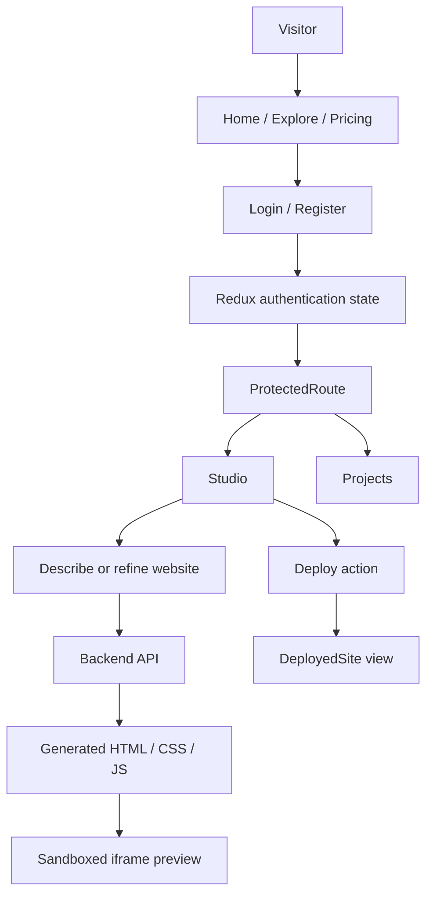
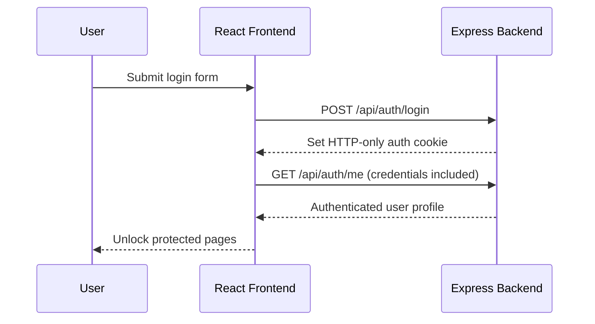
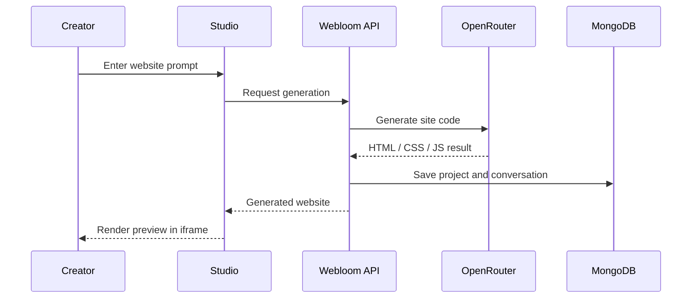

<div align="center">

# Webloom — Frontend

### Imagine it. Prompt it. Publish it.

**A conversational AI website builder with live previews, project management, and a polished creator studio.**

    

</div>

---

## Overview

**Webloom** turns natural-language descriptions into website code. Users can sign in, describe a site, view the generated result in a preview, revisit their projects, and access deployment-related experiences. The interface uses a dark, violet-accented visual system with motion-driven interactions.

## Highlights

- **AI Studio:** Conversational website generation powered by a backend AI endpoint.
- **Live preview:** Generated standalone HTML, CSS, and JavaScript displayed in a sandboxed iframe.
- **Projects workspace:** Manage and reopen previously generated websites.
- **Authentication:** Login and registration flow with protected routes and Redux Toolkit auth state.
- **Credit-aware UI:** User credits displayed in the interface; successful generations consume credits on the backend.
- **Explore & discovery:** Dedicated Explore, Why Webloom, and product pages.
- **Pricing & deployment views:** UI pages for subscription plans and deployed websites; actual availability depends on backend integration.
- **Motion-rich design:** Tailwind CSS and Framer Motion for animated interactions.

## Application flow



## Tech stack

| Area | Technology |
| --- | --- |
| UI | React, JavaScript, JSX |
| Tooling | Vite |
| Styling | Tailwind CSS v4, custom CSS |
| Animations | Framer Motion |
| State | Redux Toolkit |
| Forms | React Hook Form + Zod validation |
| Navigation | React Router |
| Backend communication | Fetch API with cookie credentials |
| Website preview | Sandboxed iframe |

## Folder structure

```text
AI_Website_Frontend/
├── public/
│   ├── favicon.svg
│   └── icons.svg
├── src/
│   ├── assets/Webloom.png
│   ├── Components/
│   │   ├── layouts/
│   │   │   ├── Footer.jsx
│   │   │   ├── Hero.jsx
│   │   │   └── Navbar.jsx
│   │   ├── LoginHero.jsx
│   │   └── ProtectedRoute.jsx
│   ├── Pages/
│   │   ├── DeployedSite.jsx
│   │   ├── Explore.jsx
│   │   ├── Home.jsx
│   │   ├── Login.jsx
│   │   ├── Pricing.jsx
│   │   ├── Projects.jsx
│   │   ├── Studio..jsx
│   │   ├── WebloomChrome.jsx
│   │   └── WhyWebloom.jsx
│   ├── Redux/
│   │   ├── authSlice.js
│   │   └── store.js
│   ├── App.jsx
│   ├── index.css
│   └── main.jsx
├── .env
├── index.html
├── package.json
└── vite.config.js
```

> **Filename check:** The supplied tree shows `Studio..jsx` (two dots). Ensure the filename and imports match; rename to `Studio.jsx` if the extra dot is accidental.

## Getting started

**Prerequisites:** Node.js, npm, and a running Webloom backend.

```bash
git clone <your-frontend-repository-url>
cd AI_Website_Frontend
npm install
```

Create a local `.env` file:

```dotenv
VITE_API_URL=http://localhost:4000
VITE_RAZARPAY_TEST_ID = your_razorpay_test_id
```

Start the development server:

```bash
npm run dev
```

Open the local address printed by Vite (typically `http://localhost:5173`).

For production:

```bash
npm run build
npm run preview
```

## Authentication and requests

Webloom uses a backend-issued JWT in an **HTTP-only cookie**. The frontend stores user/session display state in Redux, rather than persisting the token in browser JavaScript.



Use `credentials: "include"` on requests that require cookies. Configure the backend CORS origin and cookie settings for your deployed frontend domain.

## Website generation lifecycle



The implementation history uses **non-streaming** generation, with streaming discussed as a future enhancement. Do not label the AI output as token-streamed unless it is implemented in the current code.

## Pages

| Page | Purpose |
| --- | --- |
| `Home.jsx` | Landing page and product introduction |
| `Explore.jsx` | Discover Webloom and examples |
| `WhyWebloom.jsx` | Product benefits and differentiators |
| `Login.jsx` | Account access and form validation |
| `Projects.jsx` | Saved project collection |
| `Studio..jsx` | AI prompt, conversation, preview, and project editing |
| `Pricing.jsx` | Plan presentation and purchase entry point |
| `DeployedSite.jsx` | Deployment-related site experience |
| `WebloomChrome.jsx` | Specialized product UI/visual component |

## Security notes

- Keep API secrets on the **backend only**; never put OpenRouter or Razorpay secret keys in `VITE_` variables.
- Frontend route protection improves UX but does **not** replace backend authorization.
- Treat generated HTML as untrusted and retain appropriate iframe sandbox restrictions.
- Validate server responses and avoid rendering user-controlled markup directly into the main application DOM.

## Next improvements

- [ ] Confirm end-to-end deployment and deployed-site routing.
- [ ] Verify pricing checkout and payment confirmation states.
- [ ] Add clearer generation failure, retry, and insufficient-credit states.
- [ ] Add automated component and end-to-end tests.
- [ ] Improve metadata, accessibility, and responsive QA.
- [ ] Evaluate progressive AI streaming once backend support exists.

## Related repository

**Backend:** [Webloom API](../AI_Website_Backend/README.md) — authentication, projects, AI generation, credits, and payments.

---

<div align="center"><strong>Webloom</strong> · From idea to website, one prompt at a time.</div>
